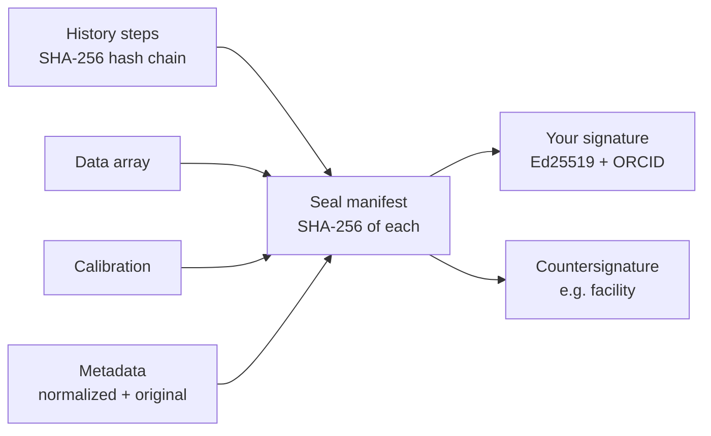

# Integrity and signatures

Provenance is only useful if it can be trusted. NUScope makes it tamper-evident in three layers.



## The seal

Every file NUScope writes contains a seal: a manifest with the SHA-256 of

- the data (dtype, shape and bytes, so the hash does not depend on the file format),
- the calibrated axes,
- the metadata: normalized, original vendor metadata, name and signal type,
- the complete history, whose steps also form a [hash chain](provenance.md#the-hash-chain).

In HDF5 the seal is stored at `/entry/nuscope/seal`. The root attributes `nuscope_seal` (the seal id) and
`nuscope_signed_by` give a readable summary in any HDF5 viewer.

## Your identity

Signatures use the researcher identity of [EMDataBridge](https://github.com/NUANCE-IT/EMDataBridge), which is
shared by NUScope, NUScope-TOMO and NUANCE-MCP: your name, your ORCID iD and an Ed25519 key.

```bash
emdb identity create "Your Name" --orcid 0000-0000-0000-0000    # or: nuscope keys create ...
emdb identity show
```

- The ORCID iD is validated, including its check digit, and stored as `https://orcid.org/…`.
- The private key is stored in `~/.emdatabridge/identity/`, readable only by you. Set
  `EMDATABRIDGE_KEY_PASSPHRASE` to keep it encrypted.
- Back the private key up. If it is lost you cannot sign as that key again, but everything it signed stays
  verifiable, because each signature carries the public key.
- Keys created by NUScope 0.3 in `~/.nuscope/keys` are imported automatically the first time they are needed.

Once you have an identity, every file you save is signed. Your name and ORCID iD also become the person in the
provenance of everything you do.

## Countersigning and trust

```bash
nuscope sign result.h5 --role facility      # add your signature to an intact, sealed file
emdb identity export me.json                # your public identity, to share
emdb identity trust colleague.json          # trust someone else's key
emdb identity list
```

A signature covers the seal and the signer record (name, ORCID iD, key fingerprint, role, time), so none of
them can be changed afterwards. A valid signature from a key you have not trusted is reported as such: the
data is intact, but you have not said you know who that key belongs to.

## Verification

```python
r = ns.verify("result.h5")
r.status        # "signed" | "sealed" | "tampered" | "unsealed"
r.checks        # {"data": True, "calibration": True, "metadata": True, "history": True, "history chain": True}
r.signatures    # [{"name": ..., "orcid": ..., "fingerprint": ..., "role": ..., "valid": True, "trusted": True}]
print(r)
```

`ns.load()` verifies every NUScope file it opens, puts the report in `ds.integrity`, warns if anything changed
after sealing, and records the result in the history. `nuscope verify file...` exits with status 1 if any file
fails. NUScope Studio shows the result in the History tab and warns when a modified file is opened.

## What it does and does not prove

!!! note
    A seal proves that a file is unchanged since it was sealed, and a signature proves who sealed it. Neither
    proves that the measurement was right. Instrument files are fingerprinted the first time NUScope reads
    them; to pin data at the source, save and sign on the acquisition computer. NUANCE-MCP does this for
    every acquisition it makes (see [NUANCE-MCP](nuance-mcp.md)).
