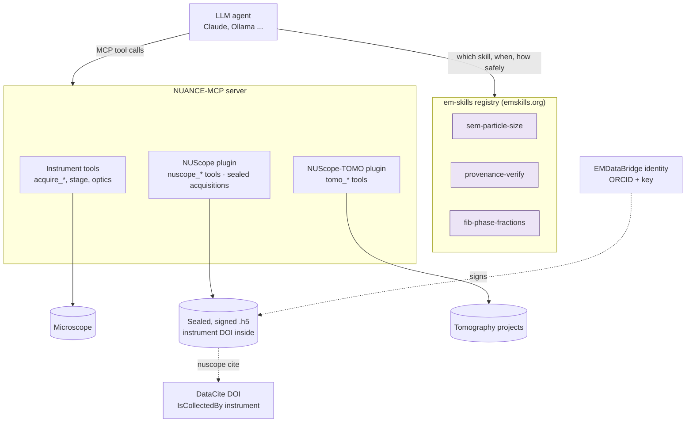

# LLMs: em-skills, NUANCE-MCP, NUScope and NUScope-TOMO

How a language model works with NUANCE data: what it may do, which code does it, and how every result stays
traceable to the instrument, the file and the person.

## The layers

| Layer | Role | Owner |
|---|---|---|
| **em-skills** | The *knowledge*: a `SKILL.md` per task tells an agent what a tool does, its scope, its safety class and its exact call, and ships a fixture with a reference check that CI runs | [emskills-mcp/em-skills](https://github.com/emskills-mcp/em-skills) |
| **NUANCE-MCP** | The *runtime*: MCP server that exposes the instrument and the plugins' tools to the agent, with schema-validated inputs | [NUANCE-IT/NUANCE-MCP](https://github.com/NUANCE-IT/NUANCE-MCP) |
| **NUScope** | Data tools (read any NUANCE file, analyze in physical units, verify) and the guarantee that every acquisition is saved as a sealed, signed file with the instrument DOI | this package |
| **NUScope-TOMO** | Tomography tools: project summaries, phase fractions with error bars, recipe runs | [NUANCE-IT/NUScope-TOMO](https://github.com/NUANCE-IT/NUScope-TOMO) |
| **EMDataBridge** | Who: the researcher's ORCID iD and signing key | [NUANCE-IT/EMDataBridge](https://github.com/NUANCE-IT/EMDataBridge) |
| **nuance-datacite** | Which instrument, and the DOI of the dataset | [NUANCE-IT/NUANCE-Data-Cite](https://github.com/NUANCE-IT/NUANCE-Data-Cite) |

A skill is not code that runs inside the model. It is a contract: *call this MCP tool with these arguments
for this kind of data, expect this result, and here is the test that proves the tool does it.* The tools
themselves live in NUScope and NUScope-TOMO and are served by NUANCE-MCP.

## Skills backed by NUScope

| Skill | Tool | Package | Safety |
|---|---|---|---|
| [`sem-particle-size`](https://github.com/emskills-mcp/em-skills/tree/main/skills/sem-particle-size) | `nuscope_analyze` (op `particles`) | NUScope | read-only |
| [`provenance-verify`](https://github.com/emskills-mcp/em-skills/tree/main/skills/provenance-verify) | `nuscope_verify` | NUScope | read-only |
| [`fib-phase-fractions`](https://github.com/emskills-mcp/em-skills/tree/main/skills/fib-phase-fractions) | `tomo_phase_fractions` | NUScope-TOMO ≥ 0.3.2 | read-only |

Each one pins the released package in its `requirements.txt`, and its `verify.py` recovers a known ground
truth from a synthetic fixture with that exact version. If a NUScope release changes a result, the registry's
CI fails before an agent ever sees the change.

## Existing skills that NUScope can serve

The registry's first skills describe tasks NUScope and NUScope-TOMO already do, or could do with small
additions. Backing them with NUScope gives them file readers for every NUANCE instrument, calibration from
metadata, and provenance.

| Skill | NUScope / NUScope-TOMO today | Gap |
|---|---|---|
| `scalebar-calibrate` | `calibrate(pixel_size_nm, reason)` records the correction in the history; `fft` + `radial_profile` measure a grating period | fit the cross-grating pitch automatically |
| `lattice-dspacing` | `fft` (1/nm axes) + `radial_profile` give periodicities in nm | peak fitting with uncertainty |
| `eels-edge-id` | reads EELS spectra and spectrum images with calibrated energy axes | edge database and fine-structure fitting |
| `fib-mill-seg` | NUScope-TOMO segmentation (random forest, U-Net) and particle analysis in 3D | lift-out path planning |
| `tomo-align` | NUScope-TOMO aligns FIB-SEM slice stacks | tilt-series (electron tomography): planned |
| `sem-topography`, `stem-drift-lock`, `edax-phase-map`, cryo-EM skills | readers and provenance | the methods themselves |

## Rules for skills built on NUScope

1. **Verify before trusting.** An agent should call `nuscope_verify` (skill `provenance-verify`) on any file
   before analyzing or publishing it, and stop if it is `tampered`.
2. **Calibration comes from the file.** Tools read pixel size, dispersion and camera length from the
   instrument's metadata. A skill never asks the model to type a pixel size, and a manual correction goes
   through `calibrate` with a reason, which is kept in the history.
3. **Results are new, sealed files.** Image results are written next to the input with the full history;
   inputs are never modified.
4. **People sign, agents don't.** Files are signed with the identity of the person running the server. An
   agent cannot sign on anyone else's behalf, and nothing is countersigned without that person.
5. **DOIs are drafts.** An agent may prepare DataCite metadata (`nuscope cite`). Creating even a draft DOI
   uses the facility's credentials and should be asked for. Publishing is permanent and is never automatic.
6. **Safety class in the manifest.** Data skills are read-only. Skills that act on the microscope declare it
   in `## Safety` and are served by NUANCE-MCP's instrument tools, with their schema limits.

## Adding a NUScope-backed skill

1. Make sure the operation is reachable as an MCP tool (`nuscope_analyze` covers every operation in
   `nuscope.analyze`; add a dedicated tool for anything else).
2. In `em-skills/skills/<slug>/`: `SKILL.md` (front matter: `kind: MCP server`, `tool_call: <tool>`,
   `org: NUANCE-IT`, `repo: NUANCE-IT/NUScope`), `examples/invoke.json`, `fixtures/generate.py` and
   `fixtures/sample/` (small, deterministic), `verify.py` that recovers the ground truth with the released
   package, and `requirements.txt` pinning it.
3. Run `python3 scripts/validate_skills.py --run` in em-skills.
